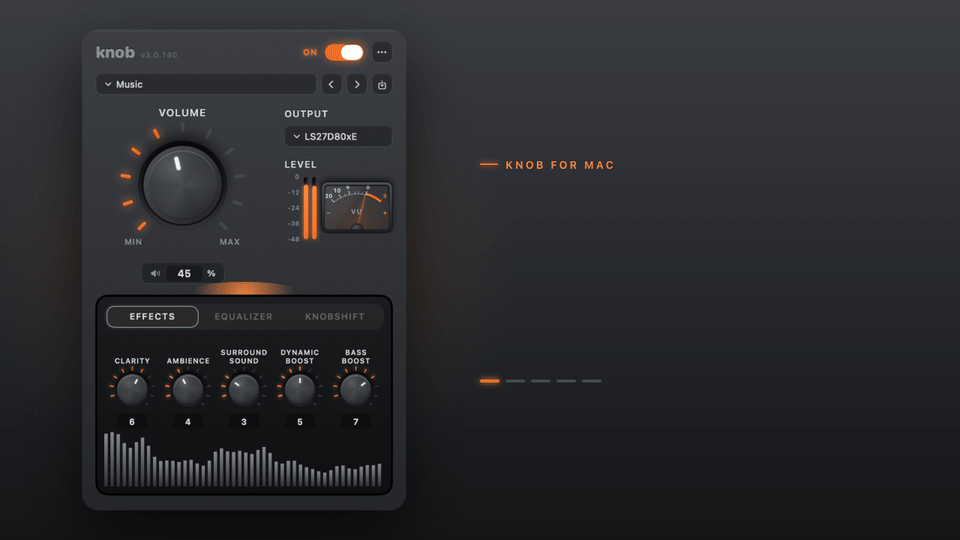
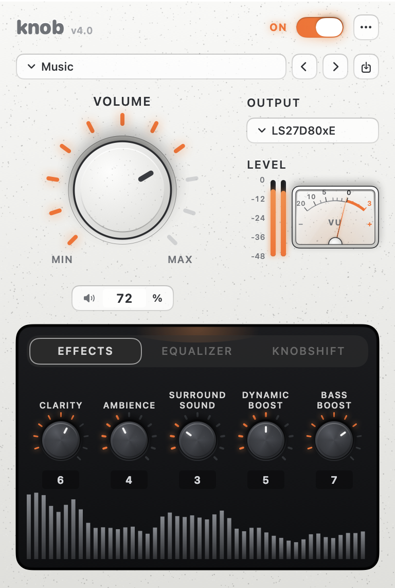
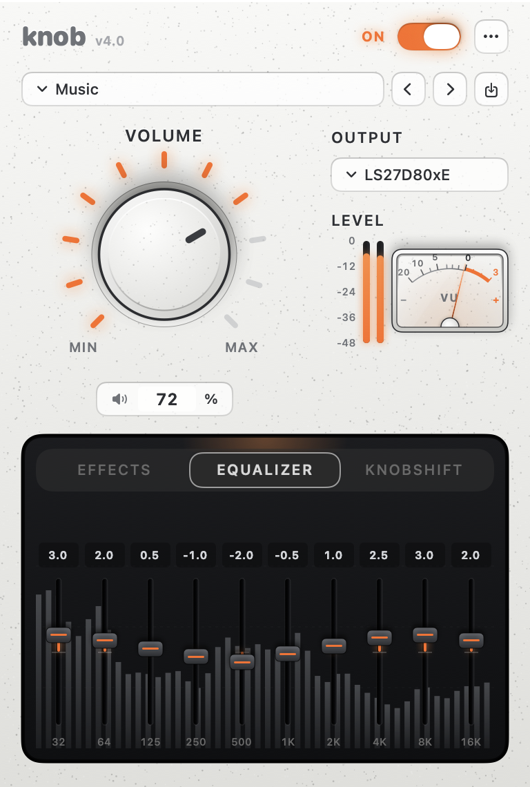

<a id="top"></a>
<div align="center">


# Knob

### Studio sound and DJ style mixes, on your Mac and iPhone.

**🆕 4.0: KnobMix rebuilt, and Knob comes to iPhone.** [See what's new](CHANGELOG.md)

<br/>



<br/>


[](https://github.com/simranxdhindsa/knob/actions/workflows/release.yml)

[✨ Features](#-features) · [🎛️ The panel](#%EF%B8%8F-the-panel) · [🧭 How it works](#-how-it-works) · [🚀 Quick start](#-quick-start) · [🛠️ Develop](#%EF%B8%8F-develop) · [📚 Docs](#-documentation)

</div>

---

## 💡 Why Knob

- 🎚️ **Studio sound** on everything you hear, on any output
- 🎧 **Songs that flow** into each other like a DJ set
- 🔊 **Volume keys that work** on HDMI and DisplayPort monitors

---

## 🎛️ The panel

<div align="center">

<picture>
  <source media="(prefers-color-scheme: dark)" srcset="docs/images/panel-dark-effects.png">
  
</picture>
&nbsp;&nbsp;
<picture>
  <source media="(prefers-color-scheme: dark)" srcset="docs/images/panel-dark-equalizer.png">
  
</picture>

<sub>Follows your Mac's light or dark mode. The analyser screen stays dark, like real gear.</sub>

</div>

---

## 🎧 KnobShift

**Add your music, press play, and every song mixes into the next.**

<div align="center">



</div>

### 🎬 Watch a KnobMix

<div align="center">
  
</div>

| | | |
|:--:|:--:|:--:|
| 🪝 **Starts at the last hook** | 🎤 **Lands on the next verse** | 🥁 **Beats in step** |
| ✂️ **On device voice split** | ⚡ **KnobMix Now** | 🔀 **Shuffle and drag** |
| 🟢 **Spotify playlists** | 🔴 **YouTube and YouTube Music** | 🔒 **Mixing stays on your device** |

---

## 📱 Mac to iPhone

**Your Mac downloads. Your iPhone plays.**

<div align="center">
  
</div>

<sub>The iPhone app has the full KnobShift player and Knob's sound controls. For now it is built from this source, it is not on the App Store.</sub>

---

## ✨ Features

| | | |
|:--:|:--:|:--:|
| 🔊 **Volume on every output** | 🎚️ **Five effects** | 📊 **10 band equalizer** |
| 🎼 **Presets** | 📈 **Live meters** | ⏻ **One switch** |

**Also included:** 💾 remembers your sound · 🛡️ restores your speakers if anything stops · 📳 trackpad haptics · 🌗 light and dark · ♿️ VoiceOver

---

## 🧭 How it works

<p align="center">
  
</p>

| | |
|---|---|
| 🎛️ **Knob audio device** | The Mac's default output while Knob is on. It owns the volume and mute that the keys control, so they work even on HDMI. |
| ⚙️ **knob-engine** | Captures that device, runs the effects and the equalizer in real time, and plays the result on your real speakers. |
| 🛡️ **knob-supervisor** | Watches the engine. If it ever stops, your Mac's normal output comes straight back, so you're never left without sound. |
| 🖥️ **Menu bar app** | Talks to the engine over a private local socket. Nothing about your audio ever leaves the Mac. |
| 🔄 **Updates** | Knob checks GitHub for signed releases and installs them itself. |

---

## 🚀 Quick start

### 💿 Install

1. Download **[Knob.dmg](https://github.com/simranxdhindsa/knob/releases/latest/download/Knob.dmg)** from the latest release.
2. Open it, then open **`Knob-Install.pkg`** and follow the steps. It asks for your Mac password once, because it adds Knob's audio device to the system.
3. Sound pauses for a moment while the Mac's audio service restarts, then Knob opens in your menu bar.
4. Flip the switch to **ON**. When macOS asks for audio access, choose **Allow**. It is only used to process sound on your Mac; nothing is recorded or sent anywhere.

<sub>Knob isn't notarized yet. If macOS says it can't verify the installer, open **System Settings → Privacy & Security** and click **Open Anyway**.</sub>

Or with [Homebrew](https://brew.sh):

```bash
brew tap simranxdhindsa/knob https://github.com/simranxdhindsa/knob
brew install --cask simranxdhindsa/knob/knob
```

### 🔄 Updates

Knob updates itself. It checks for a new version when it starts and every few hours, installs it in the background and reopens, so you never need to download it again. **Check for Updates…** in Knob's menu checks right away. Every update is signed, and Knob refuses any that isn't.

### 🔨 Build it yourself

**Prerequisites:** macOS **14** or later · Apple Command Line Tools (`xcode-select --install`) · CMake (`brew install cmake`)

```bash
git clone git@github.com:simranxdhindsa/knob.git && cd knob

cmake -S . -B build -G "Unix Makefiles" -DCMAKE_BUILD_TYPE=Release \
  -DCMAKE_OSX_ARCHITECTURES=arm64 -DCMAKE_OSX_DEPLOYMENT_TARGET=14.0
cmake --build build -j8                  # sound engine and supervisor
bash driver/build.sh "$PWD/build/driver" # audio device
app/build-app.sh                         # build/Knob.app, with the engine and audio device inside
bash scripts/release/release.sh          # dist/v<version>/: Knob.dmg with the installer (trial, publishes nothing)
```

---

## 🛠️ Develop

| Command (from repo root) | What it does |
|---|---|
| `npm run dev` | ⚡ Rebuilds and relaunches Knob about 3 seconds after every save |
| `npm run dev:demo` | 🧪 The same, on sample data: no engine or audio device needed |
| `npm run dev:once` | ▶️ Build and launch once |
| `app/build-app.sh` | 📦 Build `build/Knob.app` with the engine inside |
| `packaging/build-dmg.sh` | 💿 Build the drag-to-Applications installer in `dist/` |
| `Knob --snapshot DIR` | 📸 Render the panel in light and dark, engine on and off |
| `Knob --icons DIR` | 🎨 Render the app icon, the installer background and the About window |
| `Knob --volume-check 3` | 🔊 Check the real Mac volume path, then restore it |

`npm` is only a shortcut: there are no Node dependencies.

---

## 🏗️ Project structure

<details>
<summary><b>📁 Expand the tree</b></summary>

<br/>

```
knob/
├── app/                      SwiftUI menu bar app
│   ├── Sources/Knob/
│   │   ├── Components/       RealisticKnob, HardwareFader, SegmentedTabs, PowerSwitch…
│   │   ├── Views/            Panel, header, volume, screen, About, app icon
│   │   ├── State/            KnobModel (every action), presets, session, KnobShift player
│   │   ├── Engine/           Socket client, launcher, devices, volume handoff
│   │   └── Theme/            Palette (light/dark tokens), Motion (springs)
│   ├── Resources/            AppIcon.icns, KnobShift's vocal separation model
│   └── build-app.sh          Builds and signs Knob.app
├── driver/                   Knob audio device (AudioServerPlugIn)
├── engine/                   knob-engine and knob-supervisor (Core Audio, C++)
├── dsp/                      Effects, equalizer, presets and spectrum (real-time C/C++)
├── presets/                  Factory presets
├── tests/                    Driver, engine and DSP tests
├── packaging/                Installer, signing, uninstall, source bundle
├── scripts/dev.sh            Live dev mode
├── docs/                     Testing guides and README artwork
└── CLAUDE.md                 Architecture rules and conventions
```

</details>

---

## 📚 Documentation

| | Doc | Covers |
|---|---|---|
| 🆕 | [`CHANGELOG.md`](./CHANGELOG.md) | What's new in each version of Knob |
| 🎧 | [`knobshift.md`](./docs/knobshift.md) | How KnobShift listens, plans and mixes, with measurements against Apple Music |
| 🧪 | [`testing.md`](./docs/testing.md) | Full test suite and the bit-identical sound check |
| ✅ | [`uat-testing.md`](./docs/uat-testing.md) | How UI is verified: like a real user, not by DOM counts |
| 🎛️ | [`driver/README.md`](./driver/README.md) | The audio device's stream, clock and control contract |
| 🧱 | [`CLAUDE.md`](./CLAUDE.md) | Architecture, risk areas, design system and project rules |
| 📄 | [`NOTICE.md`](./NOTICE.md) | License and attribution notes |

---

## 🧱 Conventions that keep it clean

- **🎨 Theme tokens only.** Every colour comes from `Palette.swift`, so light and dark mode both just work.
- **🪀 One motion system.** Every animation comes from `Motion.swift`; drags follow your finger, outside changes spring into place.
- **🎛️ The engine is the source of truth.** Devices, presets, bands and ranges are read live, never hardcoded.
- **⏱️ Real-time safe.** Nothing allocates, locks or blocks on the audio thread.
- **🔁 Bit-identical sound.** Any change to the sound processing is checked against reference renders.
- **🐞 Reproduce before patching.** Bugs get reproduced against the real pipeline before a fix is claimed.

Full rules live in [`CLAUDE.md`](./CLAUDE.md).

---

## 🙌 Credits

Knob is designed and built by **[Simran Dhindsa](https://github.com/simranxdhindsa)**.

[](https://github.com/simranxdhindsa)
[](https://www.linkedin.com/in/simran-dhindsa-0aa7992b9/)

- Tabs adapted from the [Segmented Control](https://21st.dev/halaska-studio/segmented-control) by Halaska (MIT) on 21st.dev.
- Power switch adapted from the [Switch](https://21st.dev/serafimcloud/switch) by serafimcloud on 21st.dev.
- KnobShift's vocal separation uses the [Open-Unmix](https://github.com/sigsep/open-unmix-pytorch) UMX-HQ model by Inria (MIT), converted to run on device (`app/Resources/KnobShift/OpenUnmix-LICENSE.txt`).
- KnobShift's player layout is inspired by the MusicPlayerCard by dhileepkumargm on 21st.dev.
- The audio device follows Apple's AudioServerPlugIn sample code (`driver/apple-sample-license.txt`).
- Knob builds on earlier free software; its copyright and license notices are kept at the top of the files they apply to.

## 📄 License

Free software under the [GNU Affero General Public License v3](LICENSE). See [`NOTICE.md`](NOTICE.md). If you share Knob with anyone, share its source code too.

---

<div align="center">


**TURN · TUNE · FLOW**

<sub>Built by <a href="https://github.com/simranxdhindsa">Simran Dhindsa</a> · <a href="https://www.linkedin.com/in/simran-dhindsa-0aa7992b9/">LinkedIn</a></sub>

<sub><a href="#top">⬆ Back to top</a></sub>

</div>
