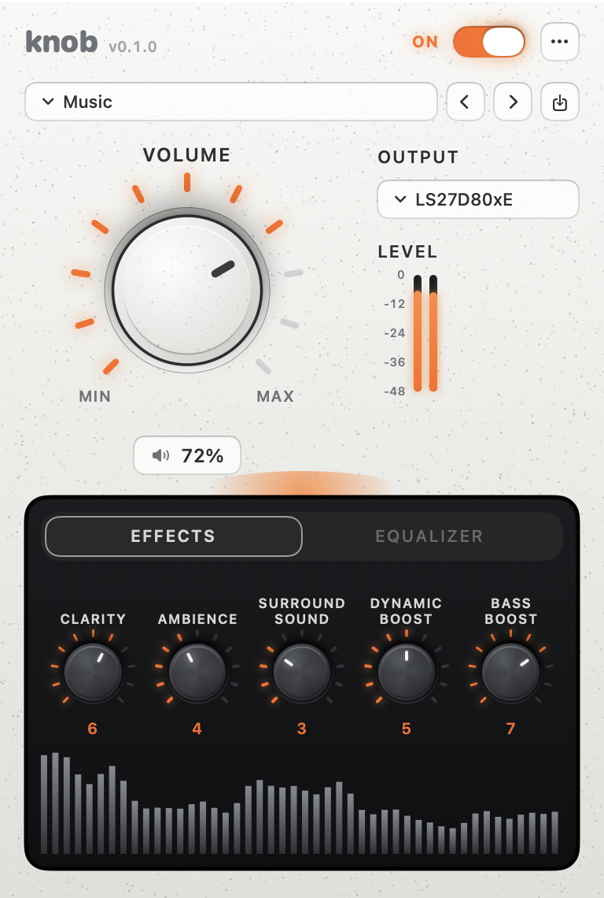
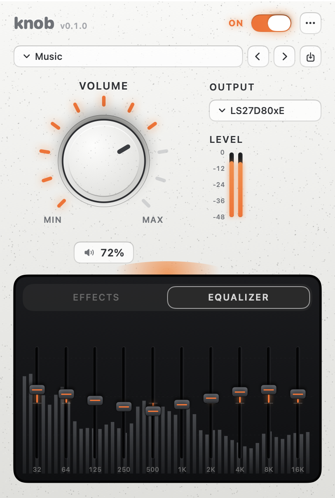

<div align="center">


### Studio sound for every output on your Mac.

A real volume knob for HDMI monitors, five effects, a 10-band equalizer and presets,<br/>all in a menu bar panel that feels like studio hardware.

<br/>


[✨ Features](#-features) · [🎛️ The panel](#%EF%B8%8F-the-panel) · [🧭 How it works](#-how-it-works) · [🚀 Quick start](#-quick-start) · [🛠️ Develop](#%EF%B8%8F-develop) · [📚 Docs](#-documentation)

</div>

---

## 💡 Why Knob

Plug a Mac into an HDMI or DisplayPort monitor and the volume keys stop working. The level is stuck at 100% and the only way to turn it down is the monitor's own buttons.

Knob places its own audio device between your apps and your speakers. The Mac treats it like real hardware, so the **volume keys, Control Center and Knob's own knob all work again, on any output**. And because every sound now passes through Knob, it can make that sound better on the way.

> **Your level never jumps.** When Knob takes over the output, it carries your volume across, and when it hands the output back, it carries it back. Nothing blasts at 100%, even after a crash.

---

## 🎛️ The panel

<div align="center">

<picture>
  <source media="(prefers-color-scheme: dark)" srcset="docs/images/panel-dark-effects.png">
  
</picture>
&nbsp;&nbsp;
<picture>
  <source media="(prefers-color-scheme: dark)" srcset="docs/images/panel-dark-equalizer.png">
  
</picture>

<sub>Follows your Mac's light or dark mode. The analyser screen stays dark, like real gear.</sub>

</div>

---

## ✨ Features

<table>
<tr>
<td width="50%" valign="top">

### 🔊 Volume for every output
HDMI, DisplayPort, USB, Bluetooth or built-in speakers. The **volume keys** and the on-screen HUD work again, and the big knob follows them with a spring while its ring of marks lights up from MIN to MAX.

</td>
<td width="50%" valign="top">

### 🎚️ Five effects
**Clarity, Ambience, Surround Sound, Dynamic Boost and Bass Boost**, each on its own realistic knob, ringed by **Marshall-style indicator marks** that light up in orange, one by one, as you turn it up. Double-click any knob to reset it.

</td>
</tr>
<tr>
<td valign="top">

### 📊 10-band equalizer
Hardware faders with a centre detent, drawn over a **live spectrum analyser** that moves with your music.

</td>
<td valign="top">

### 🎼 Presets
General, Music, Movies, Gaming, Voice, Bass Boost, Streaming Video and more, with **previous and next** buttons for quick flicking.

</td>
</tr>
<tr>
<td valign="top">

### ⏻ One switch
**ON** makes Knob your output and turns the effects on. **OFF** bypasses the effects instantly. Nothing restarts and nothing is lost.

</td>
<td valign="top">

### 💾 Remembers your sound
Every knob, fader and preset is saved a moment after you change it and comes back the next time Knob starts.

</td>
</tr>
<tr>
<td valign="top">

### 📈 Live meters
Left and right level meters on a real dB scale, and an orange glow above the screen that **breathes with the music**.

</td>
<td valign="top">

### 🛡️ Safe by design
A supervisor hands your speakers back if the engine ever stops, and Knob never leaves them stuck at full volume.

</td>
</tr>
<tr>
<td valign="top">

### 💡 Indicator marks
Eleven marks from 0 to 10 circle every knob, like the dials on a guitar amp. They glow as you turn up and stay dark when switched off, in light and dark mode.

</td>
<td valign="top">

### 📳 Haptic feedback
On a MacBook or Magic Trackpad you **feel the knob turn**: a firm tick for each notch, and the strongest click at minimum, maximum and the fader's centre.

</td>
</tr>
</table>

**Also included:** 🌗 light and dark mode · 🪀 spring animations with Framer Motion settings · 📳 trackpad haptics on knobs and faders · ♿️ VoiceOver labels and adjustable controls · ⌨️ arrow keys on the tabs · 🧪 demo mode with sample data

---

## 🧭 How it works

<p align="center">
  
</p>

| | |
|---|---|
| 🎛️ **Knob audio device** | The Mac's default output while Knob is on. It owns the volume and mute that the keys control, so they work even on HDMI. |
| ⚙️ **knob-engine** | Captures that device, runs the effects and the equalizer in real time, and plays the result on your real speakers. |
| 🛡️ **knob-supervisor** | Watches the engine. If it ever stops, your Mac's normal output comes straight back, so you're never left without sound. |
| 🖥️ **Menu bar app** | Talks to the engine over a private local socket. Nothing about your audio ever leaves the Mac. |
| 🔄 **Updates** | Knob checks GitHub for signed releases and installs them itself. |

---

## 🚀 Quick start

### 💿 Install

1. Download **[Knob.dmg](https://github.com/simranxdhindsa/knob/releases/latest/download/Knob.dmg)** from the latest release.
2. Open it, then open **`Knob-Install.pkg`** and follow the steps. It asks for your Mac password once, because it adds Knob's audio device to the system.
3. Sound pauses for a moment while the Mac's audio service restarts, then Knob opens in your menu bar.
4. Flip the switch to **ON**. When macOS asks for audio access, choose **Allow**. It is only used to process sound on your Mac; nothing is recorded or sent anywhere.

<sub>Knob isn't notarized yet. If macOS says it can't verify the installer, open **System Settings → Privacy & Security** and click **Open Anyway**.</sub>

Or with [Homebrew](https://brew.sh):

```bash
brew tap simranxdhindsa/knob https://github.com/simranxdhindsa/knob
brew install --cask simranxdhindsa/knob/knob
```

### 🔄 Updates

Knob updates itself. It checks for a new version when it starts and every few hours, installs it in the background and reopens, so you never need to download it again. **Check for Updates…** in Knob's menu checks right away. Every update is signed, and Knob refuses any that isn't.

### 🔨 Build it yourself

**Prerequisites:** macOS **14** or later · Apple Command Line Tools (`xcode-select --install`) · CMake (`brew install cmake`)

```bash
git clone git@github.com:simranxdhindsa/knob.git && cd knob

cmake -S . -B build -G "Unix Makefiles" -DCMAKE_BUILD_TYPE=Release \
  -DCMAKE_OSX_ARCHITECTURES=arm64 -DCMAKE_OSX_DEPLOYMENT_TARGET=14.0
cmake --build build -j8                  # sound engine and supervisor
bash driver/build.sh "$PWD/build/driver" # audio device
app/build-app.sh                         # build/Knob.app, with the engine and audio device inside
bash scripts/release/release.sh          # dist/v<version>/: Knob.dmg with the installer (trial, publishes nothing)
```

---

## 🛠️ Develop

| Command (from repo root) | What it does |
|---|---|
| `npm run dev` | ⚡ Rebuilds and relaunches Knob about 3 seconds after every save |
| `npm run dev:demo` | 🧪 The same, on sample data: no engine or audio device needed |
| `npm run dev:once` | ▶️ Build and launch once |
| `app/build-app.sh` | 📦 Build `build/Knob.app` with the engine inside |
| `packaging/build-dmg.sh` | 💿 Build the drag-to-Applications installer in `dist/` |
| `Knob --snapshot DIR` | 📸 Render the panel in light and dark, engine on and off |
| `Knob --icons DIR` | 🎨 Render the app icon, the installer background and the About window |
| `Knob --volume-check 3` | 🔊 Check the real Mac volume path, then restore it |

`npm` is only a shortcut: there are no Node dependencies.

---

## 🏗️ Project structure

<details>
<summary><b>📁 Expand the tree</b></summary>

<br/>

```
knob/
├── app/                      SwiftUI menu bar app
│   ├── Sources/Knob/
│   │   ├── Components/       RealisticKnob, HardwareFader, SegmentedTabs, PowerSwitch…
│   │   ├── Views/            Panel, header, volume, screen, About, app icon
│   │   ├── State/            KnobModel (every action), presets, session
│   │   ├── Engine/           Socket client, launcher, devices, volume handoff
│   │   └── Theme/            Palette (light/dark tokens), Motion (springs)
│   ├── Resources/            AppIcon.icns
│   └── build-app.sh          Builds and signs Knob.app
├── driver/                   Knob audio device (AudioServerPlugIn)
├── engine/                   knob-engine and knob-supervisor (Core Audio, C++)
├── dsp/                      Effects, equalizer, presets and spectrum (real-time C/C++)
├── presets/                  Factory presets
├── tests/                    Driver, engine and DSP tests
├── packaging/                Installer, signing, uninstall, source bundle
├── scripts/dev.sh            Live dev mode
├── docs/                     Testing guides and README artwork
└── CLAUDE.md                 Architecture rules and conventions
```

</details>

---

## 📚 Documentation

| | Doc | Covers |
|---|---|---|
| 🧪 | [`testing.md`](./docs/testing.md) | Full test suite and the bit-identical sound check |
| ✅ | [`uat-testing.md`](./docs/uat-testing.md) | How UI is verified: like a real user, not by DOM counts |
| 🎛️ | [`driver/README.md`](./driver/README.md) | The audio device's stream, clock and control contract |
| 🧱 | [`CLAUDE.md`](./CLAUDE.md) | Architecture, risk areas, design system and project rules |
| 📄 | [`NOTICE.md`](./NOTICE.md) | License and attribution notes |

---

## 🧱 Conventions that keep it clean

- **🎨 Theme tokens only.** Every colour comes from `Palette.swift`, so light and dark mode both just work.
- **🪀 One motion system.** Every animation comes from `Motion.swift`; drags follow your finger, outside changes spring into place.
- **🎛️ The engine is the source of truth.** Devices, presets, bands and ranges are read live, never hardcoded.
- **⏱️ Real-time safe.** Nothing allocates, locks or blocks on the audio thread.
- **🔁 Bit-identical sound.** Any change to the sound processing is checked against reference renders.
- **🐞 Reproduce before patching.** Bugs get reproduced against the real pipeline before a fix is claimed.

Full rules live in [`CLAUDE.md`](./CLAUDE.md).

---

## 🙌 Credits

Knob is designed and built by **[Simran Dhindsa](https://github.com/simranxdhindsa)**.

[](https://github.com/simranxdhindsa)
[](https://www.linkedin.com/in/simran-dhindsa-0aa7992b9/)

- Tabs adapted from the [Segmented Control](https://21st.dev/halaska-studio/segmented-control) by Halaska (MIT) on 21st.dev.
- Power switch adapted from the [Switch](https://21st.dev/serafimcloud/switch) by serafimcloud on 21st.dev.
- The audio device follows Apple's AudioServerPlugIn sample code (`driver/apple-sample-license.txt`).
- Knob builds on earlier free software; its copyright and license notices are kept at the top of the files they apply to.

## 📄 License

Free software under the [GNU Affero General Public License v3](LICENSE). See [`NOTICE.md`](NOTICE.md). If you share Knob with anyone, share its source code too.

---

<div align="center">


**TURN · TUNE · FLOW**

<sub>Built by <a href="https://github.com/simranxdhindsa">Simran Dhindsa</a> · <a href="https://www.linkedin.com/in/simran-dhindsa-0aa7992b9/">LinkedIn</a></sub>

<sub><a href="#">⬆ Back to top</a></sub>

</div>
